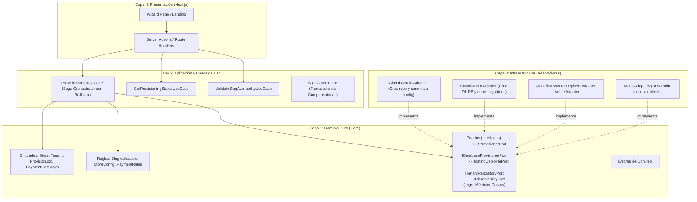
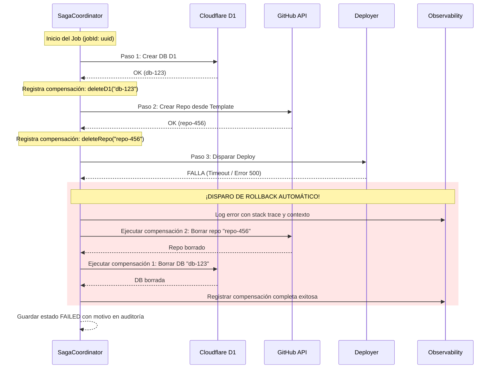

# Guía de Arquitectura Limpia y Convenciones (TuMostrador - Orquestador)

Este documento detalla la estructura hexagonal (Puertos y Adaptadores) adoptada para el Orquestador de Ecommerce, en concordancia con el ecosistema de `aura-studio`.

---

## 1. Diagrama de Capas (Hexagonal Architecture)



---

## 2. Estructura de Directorios Detallada

```text
create-a-web-app/
├── AGENTS.md                          # Principios mandatorios de desarrollo
├── GEMINI.md                          # Reglas para agentes de IA
├── ARCHITECTURE.md                    # Este documento
├── package.json
├── tsconfig.json
│
└── src/
    ├── domain/                        # CAPA 1: DOMINIO PURO
    │   ├── store/
    │   │   ├── types.ts               # Tipos de la tienda (Store, StoreBranding, StoreAdmin)
    │   │   └── rules.ts               # Reglas de validación (formato de slug, WhatsApp argentino, etc.)
    │   ├── provisioning/
    │   │   ├── types.ts               # Estados del aprovisionamiento (PENDING, CREATING_DB, etc.)
    │   │   └── rules.ts               # Reglas de transición de estados
    │   ├── ports/                     # Contratos de interfaces
    │   │   ├── git-provisioner.port.ts
    │   │   ├── database-provisioner.port.ts
    │   │   ├── hosting-deployer.port.ts
    │   │   └── tenant-repository.port.ts
    │   └── errors.ts                  # Clases de error de dominio (DomainError, ValidationError, etc.)
    │
    ├── services/                      # CAPA 2: CASOS DE USO / APLICACIÓN
    │   ├── provision-store.service.ts # Coordina la creación completa paso a paso
    │   └── validate-slug.service.ts   # Verifica disponibilidad de nombre y subdominio
    │
    ├── infra/                         # CAPA 3: INFRAESTRUCTURA (ADAPTADORES)
    │   ├── github/
    │   │   ├── octokit.adapter.ts     # Implementación real con GitHub API
    │   │   └── mock-github.adapter.ts # Mock para pruebas locales sin tokens
    │   ├── cloudflare/
    │   │   ├── d1-api.adapter.ts      # Crea DB D1 y ejecuta migraciones vía API Cloudflare
    │   │   └── mock-d1.adapter.ts     # Mock en memoria / SQLite local
    │   ├── hosting/
    │   │   ├── cloudflare-deployer.adapter.ts
    │   │   └── mock-deployer.adapter.ts
    │   └── db/                        # Base de datos interna del Orquestador (registro de comercios creados)
    │
    ├── lib/                           # UTILIDADES COMPARTIDAS
    │   ├── slugify.ts                 # Sanitizador de slugs amigables
    │   └── crypto.ts                  # Generación de contraseñas iniciales seguras
    │
    ├── components/                    # CAPA 4: COMPONENTES UI (REACT)
    │   ├── wizard/                    # Pasos del formulario de creación
    │   └── ui/                        # Botones, inputs, badges de progreso
    │
    └── app/                           # CAPA 4: NEXT.JS APP ROUTER
        ├── layout.tsx
        ├── page.tsx                   # Landing comercial
        ├── nuevo/
        │   └── page.tsx               # Creador de tienda (Wizard)
        └── api/
            └── provision/
                └── route.ts           # Endpoint de aprovisionamiento
```

---

## 3. Contratos de Puertos Clave (Interfaces)

### `IGitProvisionerPort`
```typescript
export interface CloneAndConfigureParams {
  templateRepo: string; // ej: "aura-studio"
  targetRepoName: string; // ej: "tienda-el-boliche"
  isPrivate: boolean;
  packageJsonName: string;
  wranglerConfig: {
    name: string;
    databaseName: string;
    databaseId: string;
  };
}

export interface IGitProvisionerPort {
  createAndConfigureRepository(params: CloneAndConfigureParams): Promise<{ repoUrl: string; repoFullName: string }>;
}
```

### `IDatabaseProvisionerPort`
```typescript
export interface CreateDatabaseParams {
  databaseName: string; // ej: "tienda-el-boliche-db"
  initialSeed: {
    brandName: string;
    whatsappNumber: string;
    adminEmail: string;
    adminInitialPassword: string;
  };
}

export interface IDatabaseProvisionerPort {
  createDatabase(params: CreateDatabaseParams): Promise<{ databaseId: string; databaseName: string }>;
  applyMigrationsAndSeed(databaseId: string, params: CreateDatabaseParams): Promise<void>;
}
```

### `IHostingDeployerPort`
```typescript
export interface TriggerDeployParams {
  projectName: string;
  repoFullName: string;
}

export interface IHostingDeployerPort {
  triggerDeploy(params: TriggerDeployParams): Promise<{ liveUrl: string; deploymentId: string }>;
}
```

### `IObservabilityPort`
```typescript
export interface LogContext {
  jobId?: string;
  traceId?: string;
  step?: string;
  storeSlug?: string;
  durationMs?: number;
  [key: string]: unknown;
}

export interface IObservabilityPort {
  info(message: string, context?: LogContext): void;
  warn(message: string, context?: LogContext): void;
  error(message: string, error: Error | unknown, context?: LogContext): void;
  recordMetric(metricName: string, value: number, tags?: Record<string, string>): void;
}
```

---

## 4. Patrón Saga con Rollback Compensatorio (Transacción Distribuida)

Como el aprovisionamiento involucra múltiples APIs externas (Cloudflare, GitHub, etc.), no existe una transacción ACID tradicional de base de datos. Por lo tanto, implementamos el **Patrón Saga con Acciones Compensatorias (LIFO - Last In, First Out)**:



* **Ventaja crítica:** Cero recursos huérfanos en Cloudflare ni en GitHub. Se preserva al 100% la cuota gratuita.
* **Trazabilidad:** Cada acción y compensación emite logs estructurados con `jobId` para depuración inmediata.

---

## 5. Soporte de Múltiples Medios de Pago

El orquestador configura la tienda para que acepte todos los procesadores de pago que ya están modelados en `aura-studio`:
* **Mercado Pago** (Checkout Pro, Checkout API, QR, Link de pago).
* **Payway / Prisma** (Tarjetas de crédito y débito).
* **MODO** (Pagos con QR interbancario de Argentina).
* **Getnet** (Santander).
* **Transferencia Bancaria con Descuento Automático** (ej. 10% OFF si paga por CBU/CVU y sube comprobante).
* **Efectivo contra entrega / Retiro en showroom**.

---

## 6. Filosofía de Desarrollo
* **Clean Code:** Funciones pequeñas, nombres autodescriptivos, sin comentarios obvios ni código muerto comentado.
* **Separación Real:** Los adaptadores de infraestructura se pueden intercambiar (por ejemplo, cambiar Cloudflare por otro proveedor) sin tocar ni una sola línea del caso de uso ni de la UI.
* **Modo Mock Integrado:** El proyecto siempre debe poder ejecutarse con `MOCK_MODE=true` en local para mostrar demos instantáneas a clientes o inversores sin costos de red ni tokens.

